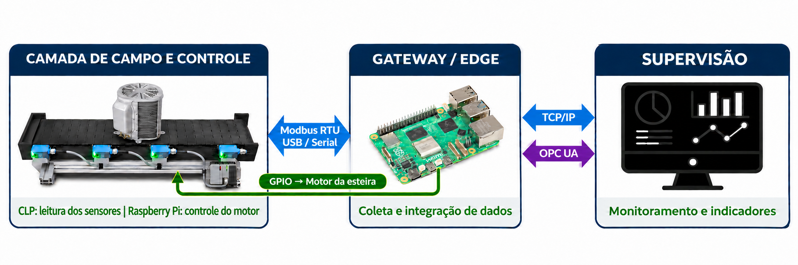

# Lean Manufacturing — Supervisão de uma linha de 12 postos

Sistema de supervisão *Lean* para uma linha didática com CLP LS XGK-CPUE, Gateway em Raspberry Pi e Dashboard web, incluindo a Instrução de Trabalho Digital (IT Digital) do posto E07 e um simulador Desktop.



```
Botões/sensores ─► CLP LS XGK ◄─Modbus RTU (RS-232)─ Raspberry Pi (Gateway) ─TCP 15000 (Andon)─► Receptor Windows ─HTTP/WS 8081─► Navegador
                                                          │   ▲                                         │                       (Dashboard, IT E07)
                                                          │   └────────────── OPC UA 4840 ◄─────────────┘
                                                          └─GPIO─► DRV8825 ─► motor da esteira
```

## Início rápido (Windows)

```powershell
python -m venv venv
.\venv\Scripts\python.exe -m pip install -r MockDesktop\requirements.txt -r Gateway\requirements.txt
cd MockDesktop
Unblock-File .\run_mock.ps1, .\run_receiver.ps1   # somente se o PowerShell bloquear os scripts
.\run_receiver.ps1        # terminal 1: receptor + Dashboard (http://127.0.0.1:8081)
.\run_mock.ps1            # terminal 2: simulador Desktop (sem o CLP)
```

Com a linha real, o simulador não é usado: o Gateway roda na Raspberry Pi (`Docs/README/README_Raspberry.md`) e o receptor aponta para ele em `[opcua_client] endpoint`.

## Documentação

| Componente | README (uso) | Documentação técnica (funcionamento e evidências) |
|---|---|---|
| Desktop (simulador) | [README_Desktop](Docs/README/README_Desktop.md) | [01_Desktop](Docs/Documentacao_Tecnica/01_Desktop.md) |
| Dashboard web | [README_Dashboard](Docs/README/README_Dashboard.md) | [02_Dashboard](Docs/Documentacao_Tecnica/02_Dashboard.md) |
| Raspberry Pi (Gateway) | [README_Raspberry](Docs/README/README_Raspberry.md) | [03_Raspberry_Gateway](Docs/Documentacao_Tecnica/03_Raspberry_Gateway.md) |
| CLP LS XGK | [README_CLP](Docs/README/README_CLP.md) | [04_CLP](Docs/Documentacao_Tecnica/04_CLP.md) |
| IT Digital E07 | [README_IT_Digital](Docs/README/README_IT_Digital.md) | [05_IT_Digital](Docs/Documentacao_Tecnica/05_IT_Digital.md) |
| APIs e protocolos | [README_APIs](Docs/README/README_APIs.md) | [06_APIs](Docs/Documentacao_Tecnica/06_APIs.md) |

- **Relatório final (LaTeX/Overleaf):** `Docs/Relatorio_Final/` (zip pronto: `Docs/Relatorio_Final_Overleaf.zip`).
- **Evidências e scripts de reprodução:** `Docs/Evidencias/`.
- **Referências existentes:** `Docs/ARQUITETURA_COMUNICACAO_LINHA.md`, `Docs/DOCUMENTACAO_CLP_LS_XGK.md`, `Docs/FLUXOGRAMA_MAQUINA_ESTADOS_CLP.md`, `Gateway/README.md`, `Gateway/README_INSTALACAO_RASPBERRY.md`, `MockDesktop/README.md`.

## Estrutura

| Pasta | Conteúdo |
|---|---|
| `Gateway/` | Serviço da Raspberry Pi: Modbus RTU, OPC UA, TCP, SNTP, SQLite, GPIO; instalador systemd em `deploy/`. |
| `MockDesktop/` | Simulador Desktop (PyQt6), receptor TCP, cliente OPC UA, Dashboard e IT Digital (FastAPI). |
| `Docs/` | Documentação, relatório final e evidências. |

## Testes

```powershell
cd MockDesktop; ..\venv\Scripts\python.exe -m pip install -r requirements-dev.txt; ..\venv\Scripts\python.exe -m pytest -q
cd ..\Gateway;  ..\venv\Scripts\python.exe -m pip install -r requirements-dev.txt; ..\venv\Scripts\python.exe -m pytest -q
```

Resultado em 21/11/2026: MockDesktop com 98 aprovados; Gateway com 64 aprovados e 2 pulados (testes de GPIO que só rodam na Raspberry).
